# /generate-views — L3 Prompt

You are executing the Cognitive Specification Runtime view generation stage.

Your objective is to transform a BASELINED canonical specification into four audience-specific structured documents in Markdown, each following a professional standard section structure and including Mermaid diagrams.

---

## Core rules

- Never invent content not present in the canonical specification.
- If a section cannot be filled from the specification: emit a [GAP] block (see format below) and continue.
- Technical identifiers (table names, control names, rule IDs, formulas): never translated, copied verbatim in both language files.
- Each view is generated as a bilingual pair (primary language first, then companion).
- Views are **not** governed by the specification lifecycle. Begin every view file with the mandatory header.

---

## Mermaid syntax constraints (mandatory — apply to every diagram)

These rules prevent rendering failures in Mermaid v11. Apply them without exception.

### sequenceDiagram

| Rule | Wrong | Correct |
|------|-------|---------|
| Aliases with `(`, `)`, `$`, or spaces MUST be double-quoted | `participant CA as Canvas App ($Ctrl)` | `participant CA as "Canvas App ($Ctrl)"` |
| Unicode arrows (`→`, `⟹`, `⇒`) forbidden in message text | `A->>B: Process → done` | `A->>B: Process - done` |
| Double quotes `"..."` forbidden inside message text | `A->>B: Set msg = "error"` | `A->>B: Set msg = error` |
| Curly braces `{...}` inside message text — replace with description | `A->>B: UpdateContext({key: val})` | `A->>B: UpdateContext - set key` |
| Single quotes `'...'` inside message text — replace with plain text | `A->>B: LookUp('Table')` | `A->>B: LookUp Table` |

### stateDiagram-v2

| Rule | Wrong | Correct |
|------|-------|---------|
| State IDs MUST be ASCII alphanumeric (`[a-zA-Z0-9_]`) | `[*] --> Entrée` | `state "Entrée" as Entree` then `[*] --> Entree` |
| Accented characters in state IDs forbidden | `MisÀDisposition --> Sortie` | `state "Mis à disposition" as MisADispo` then `MisADispo --> Sortie` |

### All diagram types

- Node IDs (flowchart) and participant IDs (sequenceDiagram) MUST be ASCII only — use the `as "Label"` / `["Label"]` syntax to display accented French text.
- Do NOT use Unicode arrows (`→`, `↓`, `⟹`) anywhere in a Mermaid block. Use ASCII arrows (`-->`, `->`, `|label|`) or plain descriptive text.
- Keep message text and labels short (under 80 characters) — long text often causes parsing issues.

---

## Mandatory view file header

Every generated Markdown view file must begin with:

```markdown
---
**Document type:** <professional name>
**Internal view:** <view_metier | view_archi | view_dev | view_agent>
**Workspace:** <workspace_id>
**Canonical spec:** <path to _specification.md>
**Spec ID:** <SP-NNN>
**Baseline date:** <date>
**Generated:** <ISO date>
**Language:** <Français | English>
**Status:** VIEW — DO NOT EDIT DIRECTLY
---
```

---

## [GAP] block format

When a mandatory or standard section cannot be filled due to insufficient source data, emit this raw HTML block in the Markdown output (pandoc will preserve it when converting to HTML):

```html
<div class="gap-block">
<div class="gap-block-header">⚠ SECTION INCOMPLÈTE — Données source insuffisantes</div>
<ul>
<li><strong>Section :</strong> [section name]</li>
<li><strong>Données requises :</strong> [what data is needed]</li>
<li><strong>Source attendue :</strong> [which CSR artifact or input would provide this]</li>
<li><strong>Action :</strong> compléter la source et relancer /generate-views</li>
</ul>
</div>
```

For English-language files, replace the French labels with their English equivalents:
- "SECTION INCOMPLÈTE — Données source insuffisantes" → "INCOMPLETE SECTION — Insufficient source data"
- "Section :" → "Section:"
- "Données requises :" → "Required data:"
- "Source attendue :" → "Expected source:"
- "Action :" → "Action:"

### [GAP] criticality levels

| Level | Behaviour |
|-------|-----------|
| **Mandatory** | Always emit [GAP] block; include in generation report as WARNING |
| **Standard** | Emit [GAP] block if no data at all; omit section silently if partial data fills at least 50% |
| **Optional** | Omit section without [GAP] if no data; note omission in generation report |

---

## KPM Filtering Policy (ADR-004 WP-4)

The canonical specification contains KPM (Knowledge Provenance Model) data: `**KPM Status:**` header, `## Inference Registry` section, `## Specification Provenance` section, and `Source` columns in spec-level data model tables.

Phase 2b parses these into: `kpm_status`, `ir_structural[]`, `ir_implementation[]`, `ir_tech_standard[]`, `ir_undefined[]`, `ir_pending_structural[]`, `ir_has_blocking`.

Apply the filtering rules below when generating each view. The canonical spec is never modified. The `_view_agent` artifact receives no filtering.

### Filtering Matrix

| KPM Element | view_metier | view_archi | view_dev | view_qa | view_agent |
|---|---|---|---|---|---|
| KPM Status | Omit | Condensed note | Include | Omit | Verbatim |
| Provenance Index | Omit | Omit | Omit | Omit | Verbatim |
| Source column (data model tables) | Omit | Ref only | Include | Include | Verbatim |
| INFERRED_DESIGN structural PENDING_VALIDATION | Alert block → SF-12 | Governance section ⚠ | Governance section ⚠ | Governance risk → QA-06 | IR verbatim |
| INFERRED_DESIGN structural USER_VALIDATED | Omit | Governance section | Governance section | Summary | IR verbatim |
| INFERRED_DESIGN implementation REGISTERED | Omit | Omit unless arch impact | Governance section | Omit | IR verbatim |
| TECH_STANDARD | Omit | Summary | Summary | Omit | IR verbatim |
| UNDEFINED_IN_SOURCE | Alert if affects BRs | Summary row | Full row | Risk entry → QA-06 | IR verbatim |

### Alert Block (view_metier → SF-12, view_qa → QA-06)

When `ir_pending_structural[]` is non-empty, emit in the relevant section:

```markdown
> ⚠ **Décision de conception à valider**
>
> La spécification contient des décisions structurelles en attente de validation par le commanditaire.
> Ces éléments doivent être confirmés avant démarrage du développement ou de la recette.
>
> | Décision | Rationale | Statut |
> |---|---|---|
> | <Élément> | <Rationale> | ⚠ EN ATTENTE DE VALIDATION |
```

English companion files:

```markdown
> ⚠ **Design Decision Requiring Validation**
>
> The specification contains structural design decisions pending stakeholder validation.
> These must be confirmed before development or testing begins.
>
> | Decision | Rationale | Status |
> |---|---|---|
> | <Élément> | <Rationale> | ⚠ PENDING VALIDATION |
```

### Governance Section (view_archi → after DAT-06, view_dev → after STD-08b)

When `ir_structural[]` or `ir_implementation[]` contains relevant entries, add section:

```markdown
## Gouvernance des décisions de conception

> Ces éléments ont été introduits lors de la génération de la spécification.
> Ils ne sont pas directement tracés dans la base de connaissances source (ADR-004 Engagement #6).

| Élément | Type | Impact | Statut | Rationale |
|---|---|---|---|---|
| <Élément> | INFERRED_DESIGN | structural | ⚠ PENDING_VALIDATION | <Rationale> |
| <Élément> | INFERRED_DESIGN | structural | USER_VALIDATED | <Rationale> |
| <Élément> | INFERRED_DESIGN | implementation | REGISTERED | <Rationale> |
```

`view_archi` scope: structural entries (all) + implementation entries with clear architectural impact.
`view_dev` scope: ALL IR entries (structural + implementation).

English companion: `## Design Decision Governance`

If no entries relevant to the view's audience: omit the section silently (Standard criticality).

### view_agent — Complete, No Filtering

After all ENTITY[], RULE[], WORKFLOW[] blocks, emit an `INFERENCE_REGISTRY[]` block:

```
INFERENCE_REGISTRY[kpm_status: <kpm_status>]:
  structural_pending:
    - element: "<Élément>" | rationale: "<Rationale>" | statut: PENDING_VALIDATION
  structural_validated:
    - element: "<Élément>" | statut: USER_VALIDATED
  implementation_registered:
    - element: "<Élément>" | rationale: "<Rationale>" | statut: REGISTERED
  tech_standard: (entries or none)
  undefined_in_source: (entries or none)
```

If all lists are empty (T-MODE, no spec-level decisions): emit `INFERENCE_REGISTRY[kpm_status: NO_PROVENANCE_INDEX]: none`.

---

## Document naming map

| Internal view ID | FR professional name | EN professional name | FR filename suffix | EN filename suffix |
|------------------|----------------------|----------------------|--------------------|--------------------|
| view_metier      | Spécification Fonctionnelle | Functional Specification | `_specification_fonctionnelle_fr.md` | `_functional_specification_en.md` |
| view_archi       | Dossier d'Architecture Technique | Technical Architecture Document | `_dossier_architecture_fr.md` | `_technical_architecture_en.md` |
| view_dev         | Spécification Technique Détaillée | Detailed Technical Specification | `_specification_technique_fr.md` | `_technical_specification_en.md` |
| view_qa          | Plan de Tests | Test Plan | `_plan_tests_fr.md` | `_test_plan_en.md` |
| view_agent       | (Markdown only — no HTML export) | (Markdown only — no HTML export) | `_view_agent_fr.md` | `_view_agent_en.md` |

---

## Document 1 — Spécification Fonctionnelle (view_metier)

**Standard reference:** ISO/IEC/IEEE 29148:2018 + BABOK v3

**Content scope:** Business-readable content only. No schema names, no formulas, no control identifiers, no regex.

**KPM/Governance (ADR-004 WP-4):** Apply the KPM Filtering Policy. If `ir_pending_structural[]` is non-empty: emit the Alert Block in section `[SF-12] Éléments ouverts`, before the PENDING_PO_INPUT table. Omit KPM Status, Provenance Index, INFERRED_DESIGN implementation, and TECH_STANDARD entries entirely.

### Section structure

Generate the following sections in order. Apply the content scope strictly.

---

### [SF-01] Page de couverture

Emit the following raw HTML cover block:

```html
<div class="cover-page">
{{LOGO_BLOCK}}
<div class="cover-doc-type">Spécification Fonctionnelle</div>
<h1 class="cover-title">{{SYSTEM_TITLE}}</h1>
<div class="cover-subtitle">{{WORKSPACE_DESCRIPTION}}</div>
<table class="cover-meta">
  <tr><td>Workspace</td><td>{{WORKSPACE_ID}}</td></tr>
  <tr><td>Référence</td><td>{{SPEC_ID}}</td></tr>
  <tr><td>Version</td><td>{{VERSION}}</td></tr>
  <tr><td>Date de base</td><td>{{BASELINE_DATE}}</td></tr>
  <tr><td>Statut</td><td><span class="badge badge-baselined">BASELINED</span></td></tr>
  <tr><td>Langue</td><td>Français</td></tr>
</table>
</div>
```

Replace `{{LOGO_BLOCK}}` with `` if a logo path is set in the workspace registry; omit the img tag if no logo.

Replace `{{SYSTEM_TITLE}}` with the system name from the specification header.

Replace `{{VERSION}}` with the spec ID (e.g., SP003).

---

### [SF-01b] Historique des Révisions

<!-- AUTO-GENERATED — DO NOT EDIT -->

**Generation rule (DQM-2):** Parse the workspace lifecycle registry for all events of type `INITIAL_BASELINE` and `EVOLVE_BASELINE`, ordered chronologically.

- If no `INITIAL_BASELINE` event exists: **omit this entire section** — not a `[GAP]` condition (the view is generated before formal baseline).
- If events exist: emit the table below with one row per event. Number rows sequentially: v1.0, v2.0, v3.0, ...

| Version | Date | Nature | Description |
|---------|------|--------|-------------|
| v1.0 | {{INITIAL_BASELINE_DATE}} | Baseline initiale | Première version officielle |
| v2.0 | {{EVOLVE_BASELINE_DATE}} | {{EVOLVE_NATURE}} | {{EVOLVE_DESCRIPTION or —}} |

The same history appears identically across all four views generated from the same canonical specification.

**`{{EVOLVE_NATURE}}` (E7):** `Évolution fonctionnelle` or `Évolution documentaire`, derived in Phase 2d from which element families the EVOLVE change set actually touched. A version number says a document changed; it does not say whether the *system being specified* changed. A reader who must re-plan on a functional change, and need not on a documentary one, cannot tell them apart from `v2.0` alone.

`Corrective` is **not** part of the derived vocabulary: whether a change fixed an error is a judgement about intent, not a fact readable from the change set, and inventing it would be inventing content. A human may write it; CSR may not.


---

### [SF-02] Table des matières

Emit a manual TOC block listing **only the sections actually emitted in this document**. The list below is the full expected set; a conditional section that was omitted (SF-01b revision history, SF-04b hypotheses) must not appear in it, or its entry becomes a dead link. **The `<div class="toc">` container itself is mandatory even when the list is short** — `/export-views` rebuilds the entries from the headings actually present, but it does not invent a missing container, and `csr-check` W7 reports a view that has none.

```html
<div class="toc">
<h2>Table des matières</h2>
<ol>
<li><a href="#sf-03">Résumé exécutif</a></li>
<li><a href="#sf-04">Contexte et objectif du système</a></li>
<li><a href="#sf-04b">Hypothèses et dépendances</a></li>
<li><a href="#sf-05">Profils utilisateurs et acteurs</a></li>
<li><a href="#sf-06">Périmètre fonctionnel</a></li>
<li><a href="#sf-07">Flux métier</a></li>
<li><a href="#sf-08">Règles de gestion</a></li>
<li><a href="#sf-09">Interfaces utilisateur</a></li>
<li><a href="#sf-10">Exigences non fonctionnelles et contraintes</a></li>
<li><a href="#sf-11">Glossaire</a></li>
<li><a href="#sf-12">Éléments ouverts</a></li>
<li><a href="#sf-13">Validation et signatures</a></li>
</ol>
</div>
```

---

### [SF-03] Résumé exécutif {#sf-03}

**Content:** 3–5 paragraph plain-language summary of the system. What it is, who uses it, what problem it solves, key outcomes. Derived from the specification introduction and business context.

**Criticality:** Mandatory. [GAP] if no system description exists in specification.

---

### [SF-04] Contexte et objectif du système {#sf-04}

**Content:**
- Organisation context (who the client is, what they do)
- Problem statement (what was being solved)
- Solution description (what the system does in one paragraph)
- Key business outcomes expected

**Criticality:** Mandatory.

---

### [SF-04b] Hypothèses et dépendances {#sf-04b}

**Content:** Two sub-sections documenting the assumptions underlying the specification and the external dependencies that condition the solution.

**Sub-section A — Hypothèses**

Conditions assumed to be true at the time of specification that have not been formally verified, or that could become invalid if context changes. State in plain business language; no technical identifiers.

| # | Hypothèse | Impact si invalide |
|---|-----------|-------------------|
| H-001 | [assumption text in business language] | [consequence if assumption fails] |

**Sub-section B — Dépendances Externes**

External elements (systems, pending approvals, organizational decisions, legal requirements) on which the solution depends.

| # | Dépendance | Type | Statut |
|---|------------|------|--------|
| D-001 | [dependency description] | Système / Organisationnel / Réglementaire / Légal | Confirmé / En cours / À valider |

**LEGACY mode sourcing:** Extract from `## 4. Assumptions` (Hypothèses sub-section) and `## 5. Constraints` for external constraints and dependencies.

**STD mode sourcing:** Inferred from:
- `stm_context` (S1): contextual assumptions or preconditions embedded in the business context description
- `stm_decisions` (S4): D-NNN decisions with pending external approvals → Dépendances rows; conditional decisions with unvalidated status → Hypothèses rows
- `stm_open_points` (S13): OP-NNN items pending legal, HR, or organizational validation → Hypothèses rows (the assumption is that the validation will be obtained before development begins)

Derivation rules for STD:
- For each D-NNN with an external approval pending (e.g., "approbation en cours", "validation requise"): create one Dépendance row
- For each OP-NNN pending legal/HR/organizational validation: create one Hypothèse row
- From `stm_context`: identify stated preconditions or implicit assumptions about the organizational context and surface them as Hypothèse rows

**English companion heading:** "Assumptions and Dependencies"; sub-sections "Assumptions" and "External Dependencies"; column headers translated accordingly (e.g., "# | Assumption | Impact if invalid" and "# | Dependency | Type | Status").

**Criticality:** Standard. Emit [GAP] block if no assumptions or external dependencies can be derived from the specification content.

---

### [SF-05] Profils utilisateurs et acteurs {#sf-05}

**Content:** Table of actor profiles with columns: Profil, Description, Droits principaux, Restrictions.

Extract from the specification's actor/user profile definitions (business language only — no schema names).

**Mermaid diagram — Actor relationships:**

After the table, generate a Mermaid flowchart showing how actors interact with the system:

```markdown
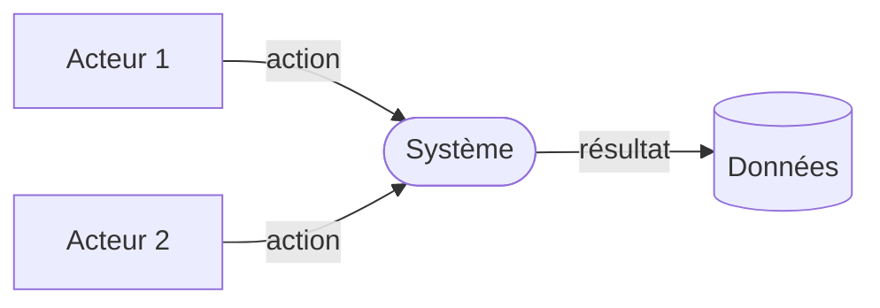
```

Replace actors and actions with real values from the specification. If no actor data: emit [GAP] block (Mandatory).

---

### [SF-06] Périmètre fonctionnel {#sf-06}

**Content:** Two-column list.
- **Inclus dans le périmètre:** bullet list of functional domains covered
- **Exclus du périmètre:** bullet list of what is explicitly out of scope (if stated in spec)

**Criticality:** Standard. [GAP] if no scope data available.

---

### [SF-07] Flux métier {#sf-07}

**Content:** For each major end-to-end business process identified in the specification:

1. Sub-section heading with the flow name
2. Brief description (2–3 sentences, business language only)
3. Mermaid flowchart of the flow:

```markdown
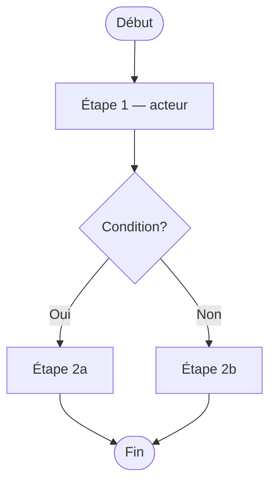
```

**State machine diagram:** If the specification defines a lifecycle for a business object (lot, commande, dossier…), generate a state diagram:

```markdown
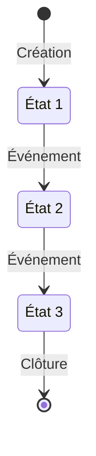
```

Use real state names and transition labels from the specification.
**Important:** State IDs (`Etat1`, `Etat2`, `Etat3`) MUST be ASCII. Use `state "Libellé FR" as AsciiId` for French labels (see Mermaid syntax constraints above).

**Criticality:** Standard. If no flows extracted: [GAP] block.

---

### [SF-08] Règles de gestion {#sf-08}

**LEGACY mode content:** Table of all Business Rules (BR-NNN) from the specification.

| Identifiant | Libellé | Domaine | Priorité | Statut |
|-------------|---------|---------|----------|--------|
| BR-001 | Plain-language rule text (no formulas, no regex) | Domain name | HIGH/MEDIUM/LOW | OPEN/PENDING_PO_INPUT |

- Strip all technical content from rule text (formulas, control names, schema references). Keep only the business intent.
- Group rules by domain.
- Add a summary count line after the table: `**Total : N règles de gestion**`

**STD mode content:** Two sub-tables in sequence.

**Sub-table A — Règles Métier (BR-NNN)** (from `stm_br`):

| Identifiant | Libellé | Domaine | Priorité | Statut |
|-------------|---------|---------|----------|--------|
| BR-001 | Plain-language rule text (strip formulas/regex) | Domain | HAUTE/MOYENNE/BASSE | ACTIF |

**Sub-table B — Exigences Fonctionnelles (FR-NNN)** (from `stm_fr`): Present in STD mode to give business stakeholders visibility on system capabilities derived from BRs.

| Identifiant | Capacité système | BR Source | Priorité | Statut |
|-------------|-----------------|-----------|----------|--------|
| FR-001 | Plain-language description of what the system does | BR-001 | HAUTE | ACTIF |

- In Sub-table B, strip all technical detail. Keep business-readable capability statements only.
- Add a summary line after each sub-table: `**Total : N règles de gestion**` / `**Total : N exigences fonctionnelles**`

**Criticality:** Mandatory. [GAP] if no BR-NNN rules found in specification.

---

### [SF-09] Interfaces utilisateur {#sf-09}

**Content:** High-level description of screens and navigation (no control identifiers, no screen names as technical references).

Describe what each main screen allows the user to do (1–2 sentences per screen). Do not list control identifiers or Canvas App technical names.

**Navigation diagram:**

```markdown
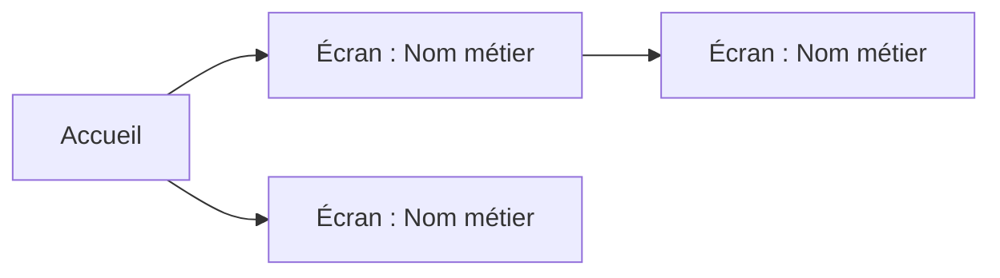
```

**Criticality:** Optional. Omit section with a brief note in the report if no screen data found.

---

### [SF-10] Exigences non fonctionnelles et contraintes {#sf-10}

**LEGACY mode content:** Table of Constraints (C-NNN) from the specification in business-readable language.

| Identifiant | Type | Description (plain language) | Statut |
|-------------|------|------------------------------|--------|
| C-001 | Performance / Sécurité / Conformité / Infrastructure | Plain-language description | OPEN |

**STD mode content:** Table of Non-Functional Requirements (NFR-NNN) from `stm_nfr` (Section 11). C-NNN is deprecated in STD workspaces; do not surface C-NNN in SF-10 for STD specs.

| Identifiant | Catégorie | Description (plain language) | Seuil | Statut | Niveau de preuve |
|-------------|-----------|------------------------------|-------|--------|------------------|
| NFR-001 | Performance / Disponibilité / Capacité / Sécurité / Contrainte | Plain-language description | ≤ Xs / ≥ X% / — | ACTIF | Non démontré à ce jour |

Strip technical values (env IDs, service accounts, version numbers) where they are not meaningful to a business reader. Keep the NFR intent and threshold in business-readable form.

**`Niveau de preuve` (ADR-007) — rendering rule.** The canonical carries machine-readable fields; the view carries a sentence a business reader understands. Translate, never recompute:

| Canonical `Preuve` | Rendered in the view |
|---|---|
| `NON_DÉMONTRÉ` | **Non démontré à ce jour** |
| `DÉMONTRÉ` + `Démontré en <scope>` + `Mesuré <value>` | **Démontré en \<scope\> — valeur mesurée \<value\>** |
| `INFIRMÉ` + `Mesuré <value>` | **Non atteint — valeur mesurée \<value\>** |

A scope names where the proof was obtained, so it also names where it was **not**. When the canonical records `UAT`, write *Démontré en UAT* — never *Démontré*, which a reader will take to mean production. This is the whole purpose of the column: preventing a reader from concluding more than the evidence supports.

`Non démontré à ce jour` is **not** a `[GAP]`. The specification is complete; the measurement has not happened yet. Never substitute a `[GAP]` block for it.

**Criticality:** Standard.

---

### [SF-11] Glossaire {#sf-11}

**Content:** Table of key business terms.

| Terme | Définition | Entité liée |
|-------|------------|-------------|
| Lot | Definition in business language | — |

Extract from the specification's terminology section. Business terms only — no schema or technical identifiers.

**Criticality:** Standard.

---

### [SF-12] Éléments ouverts {#sf-12}

**LEGACY mode content:** Table of PENDING_PO_INPUT and PENDING_CLARIFICATION items, plus KPM alert block (if `ir_pending_structural[]` is non-empty — see KPM Filtering Policy).

| Identifiant | Type | Question ouverte | Contact | Statut |
|-------------|------|------------------|---------|--------|
| BR-013 | PENDING_PO_INPUT | Description of what is missing | Name | En attente |

If no pending items: write `Aucun élément ouvert à ce stade.`

**STD mode content:** Table of Open Points (OP-NNN) from `stm_open_points` (Section 13). OP-NNN replaces PENDING flags in STD workspaces; do not surface ADVISORY UNRESOLVED flags as SF-12 rows for STD specs.

| Identifiant | Description | Impact | Priorité | Statut | Responsable | Résolution attendue |
|-------------|-------------|--------|----------|--------|-------------|---------------------|
| OP-001 | Plain-language description of the open point | BLOCKING / ADVISORY | HAUTE / MOYENNE | OPEN / IN_PROGRESS | — | Prochaine étape |

**`Responsable` (E4):** copy the canonical Section 13 value verbatim. Render `—` as **`Non attribué`** — a dash in a business document reads as an oversight, where the point is that the assignment conversation has not happened yet. Never infer an owner.

If `stm_open_points` is empty: write `Aucun point ouvert à ce stade.`

After the OP-NNN table (or the empty message), apply the KPM alert block if `ir_pending_structural[]` is non-empty (same as LEGACY path — see KPM Filtering Policy).

**Criticality:** Mandatory (always include, even if empty).

---

### [SF-13] Validation et signatures {#sf-13}

**Content:** Sign-off table with empty fields for human completion.

| Rôle | Nom | Date | Signature | Verdict |
|------|-----|------|-----------|---------|
| Product Owner | | | | |
| Responsable métier | | | | |
| Rédacteur CSR | | | | |

**Criticality:** Mandatory.

---

## Document 2 — Dossier d'Architecture Technique (view_archi)

**Standard reference:** C4 Model (Simon Brown) + IEEE 1016 SDD + Arc42

**Content scope:** Architecture and infrastructure content. Include: table names (schema level only), environment names, integration flows, ADRs. Exclude: field-level detail, formulas, control identifiers, screen names.

**KPM/Governance (ADR-004 WP-4):** Apply the KPM Filtering Policy. If `ir_structural[]` or `ir_undefined[]` is non-empty: add a `## Gouvernance des décisions de conception` section after `[DAT-06] Modèle de données`. Include structural IR entries (all) + implementation entries with clear architectural impact. Omit Provenance Index and TECH_STANDARD entries that have no architectural relevance.

### Section structure

---

### [DAT-01] Page de couverture

Same structure as SF-01 with `cover-doc-type` = "Dossier d'Architecture Technique".

---

### [DAT-01b] Historique des Révisions

<!-- AUTO-GENERATED — DO NOT EDIT -->

**Generation rule (DQM-2):** Parse the workspace lifecycle registry for all events of type `INITIAL_BASELINE` and `EVOLVE_BASELINE`, ordered chronologically.

- If no `INITIAL_BASELINE` event exists: **omit this entire section** — not a `[GAP]` condition (the view is generated before formal baseline).
- If events exist: emit the table below with one row per event. Number rows sequentially: v1.0, v2.0, v3.0, ...

| Version | Date | Nature | Description |
|---------|------|--------|-------------|
| v1.0 | {{INITIAL_BASELINE_DATE}} | Baseline initiale | Première version officielle |
| v2.0 | {{EVOLVE_BASELINE_DATE}} | {{EVOLVE_NATURE}} | {{EVOLVE_DESCRIPTION or —}} |

The same history appears identically across all four views generated from the same canonical specification.

---

### [DAT-02] Table des matières

Emit a manual TOC block listing all sections DAT-03 through DAT-11 (including DAT-03b Stratégie architecturale, DAT-08b Concepts transversaux, DAT-09b Exigences qualité — DOC-RT-04).

```html
<div class="toc">
<h2>Table des matières</h2>
<ol>
<li><a href="#dat-03">Vue d'ensemble et contexte système</a></li>
<li><a href="#dat-03b">Stratégie architecturale</a></li>
<li><a href="#dat-04">Décisions d'architecture (ADRs)</a></li>
<li><a href="#dat-05">Vue des conteneurs — composants et responsabilités</a></li>
<li><a href="#dat-06">Modèle de données</a></li>
<li><a href="#dat-07">Flux d'intégration</a></li>
<li><a href="#dat-08">Vue de déploiement</a></li>
<li><a href="#dat-08b">Concepts transversaux</a></li>
<li><a href="#dat-09">Contraintes techniques (TR-NNN)</a></li>
<li><a href="#dat-09b">Exigences qualité</a></li>
<li><a href="#dat-10">Risques et mitigations</a></li>
<li><a href="#dat-11">Traçabilité exigences → architecture</a></li>
</ol>
</div>
```

---

### [DAT-03] Vue d'ensemble et contexte système {#dat-03}

**Content:** System overview paragraph + C4 Level 1 Context diagram.

```markdown
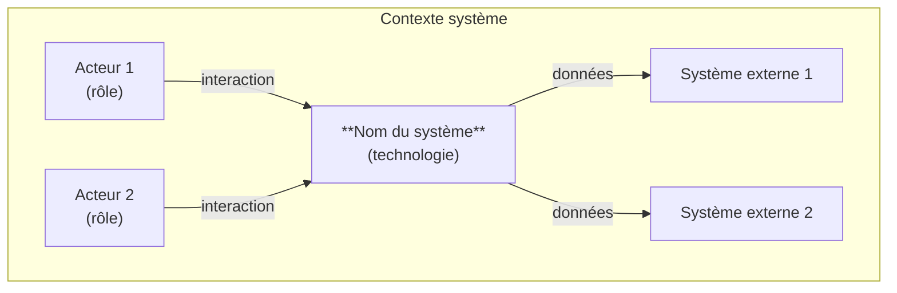
```

Use real actor names and system names from the specification. Mark external systems (Dataverse, Power Platform, external APIs) distinctly.

**Criticality:** Mandatory.

---

### [DAT-03b] Stratégie architecturale {#dat-03b}

**Content:** Synthesis of the fundamental architectural choices made for the system, their motivations, and the alternatives that were rejected. Enables an external architect or technical reviewer to quickly understand why this architecture was chosen. Corresponds to Arc42 Chapter 4 — Solution Strategy.

**Sub-section A — Approche stratégique**
Plain-text description (3–5 sentences) of the dominant architectural approach: ecosystem chosen, key constraints that shaped the design, strategic alignment factors (organizational, budget, licensing). Reference architecture decisions (D-NNN) that justify the approach.

**Sub-section B — Choix architecturaux et alternatives écartées**

| Aspect | Choix retenu | Alternative(s) écartée(s) | Justification |
|--------|-------------|--------------------------|---------------|
| [architectural domain] | [retained decision — from D-NNN] | [what was rejected] | [why — from D-NNN justification] |

One row per significant architectural decision. "Aspect" = the dimension of the decision (e.g., Plateforme IHM, Couche de stockage, Authentification, Exports).

**Sub-section C — Principes directeurs**
Bullet list of 3–6 guiding architectural principles derived from the aggregate pattern of decisions: what the architecture optimizes for, what constraints it must always respect.

**LEGACY mode sourcing:** Extract from `## 3. Design Decisions` with architectural justifications + `## 2. Context and Background` for organizational context.

**STD mode sourcing:**
- `stm_decisions` (S4): all D-NNN decisions with Justification column → Sub-section B rows (retained choice + rejected alternatives + justification); aggregate into Sub-section A strategic prose and Sub-section C principles
- `stm_context` (S1): organizational context, ecosystem constraints → Sub-section A strategic prose
- `stm_tr` (S5.2 TR-NNN): technical rules with architectural scope → supplement Sub-section C principles

Derivation rules for STD:
- For each D-NNN decision: one row in Sub-section B table
- From `stm_context` + D-NNN cluster: compose 3–5 sentence strategic approach in Sub-section A
- From repeating themes across D-NNN (cost optimization, platform reuse, licensing, compliance): derive 3–6 guiding principles in Sub-section C

**English companion heading:** "Architectural Strategy"; sub-sections "Strategic Approach" / "Architectural Choices and Rejected Alternatives" / "Guiding Principles".

**Criticality:** Standard. Emit [GAP] block if stm_decisions is empty (no architecture decisions documented in the specification).

---

### [DAT-04] Décisions d'architecture (ADRs) {#dat-04}

**Content:** Table of architecture decisions from the specification.

| ADR | Décision | Justification | Conséquences | Statut |
|-----|----------|---------------|--------------|--------|
| ADR-001 | Decision statement | Why it was made | Trade-offs and impacts | ACCEPTED |

Extract from specification's design decisions section. If no ADRs found: [GAP] (Standard).

---

### [DAT-05] Vue des conteneurs — composants et responsabilités {#dat-05}

**Content:** Description of each major component/container with its responsibility.

C4 Level 2 Container diagram:

```markdown
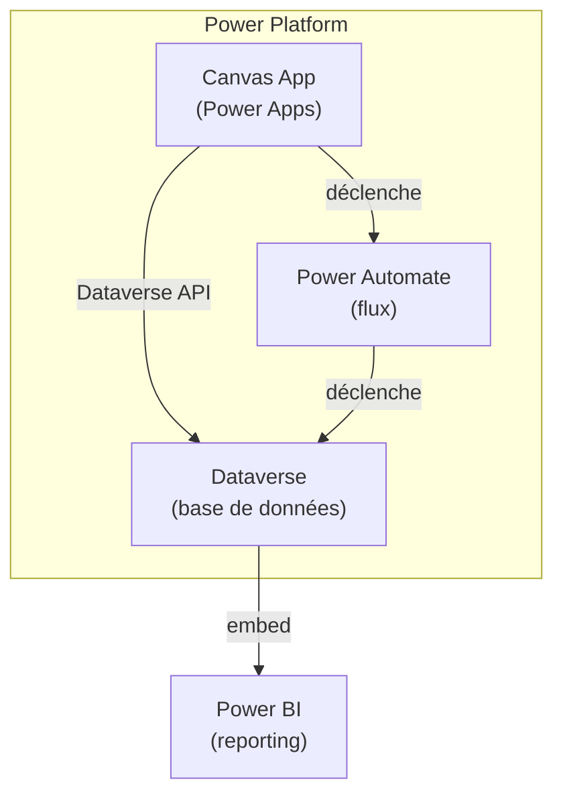
```

Use real component names from the specification.

**Criticality:** Mandatory.

---

### [DAT-06] Modèle de données {#dat-06}

**Content:** ER diagram at table level (table names and relationships only — no field-level detail).

```markdown
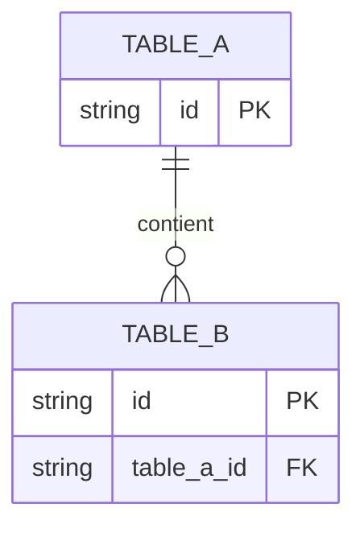
```

Use real Dataverse table schema names. List tables and their relationships. Do not include individual column definitions at this level.

**Criticality:** Mandatory. [GAP] if no table names found in specification.

---

### [DAT-07] Flux d'intégration {#dat-07}

**Content:** For each major integration flow (Power Automate, API calls, scheduled flows):

1. Flow name + description
2. Sequence diagram:

```markdown
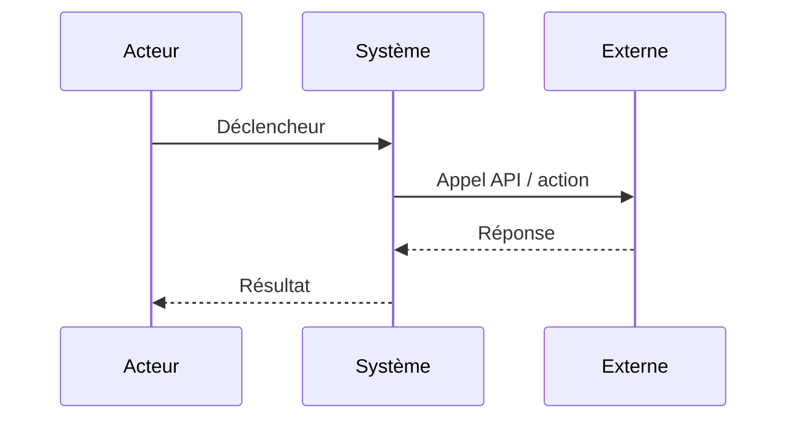
```

**Criticality:** Standard. [GAP] if no integration flows identified.

---

### [DAT-08] Vue de déploiement {#dat-08}

**Content:** Environments (dev, UAT, prod), service accounts, deployment pipeline description.

Deployment diagram:

```markdown
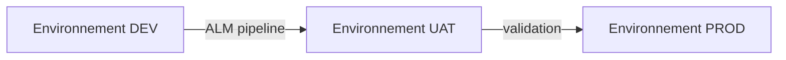
```

**Criticality:** Standard.

---

### [DAT-08b] Concepts transversaux {#dat-08b}

**Content:** Cross-cutting architectural concerns that apply to all components of the system: security, data retention, error handling, and monitoring. Enables an architect to understand the system-wide constraints and patterns that every component must respect. Corresponds to Arc42 Chapter 8 — Cross-Cutting Concepts.

**Sub-section A — Sécurité et authentification (cross-cutting)**

Authentication mechanisms across all components:

| Composant | Mécanisme auth | Population | Source |
|-----------|---------------|------------|--------|
| [component name] | [auth mechanism] | [user group covered] | [D-NNN or TR-NNN] |

RBAC and authorization (cross-cutting):

| Rôle | Composants accessibles | Mécanisme de contrôle | Source |
|------|----------------------|----------------------|--------|
| [role] | [accessible scope] | [how enforced] | [FR-NNN or TR-NNN] |

**Sub-section B — Rétention et conformité**

Retention policy applying to all persistent storage components:

| Composant / Entité | Durée de rétention | Règle associée | Source |
|--------------------|-------------------|----------------|--------|
| [entity or storage component] | [retention duration] | [policy or regulation] | [NFR-NNN or TR-NNN] |

If no retention policy specified in the source: emit [GAP] block (Standard criticality).

**Sub-section C — Gestion des erreurs**

Cross-cutting error handling pattern (1–3 sentences): what error strategy the system applies across components (user-facing messages, blocking behavior, fallback paths). Reference TR-NNN or OP-NNN specifying error handling requirements.

If not specified in the source: emit [GAP] block (Standard criticality).

**Sub-section D — Journalisation et monitoring**

Cross-cutting logging and monitoring strategy (1–2 sentences): audit trail requirements, operational monitoring approach.

If not specified in the source: emit [GAP] block (Standard criticality — absent from most specifications; this is the expected outcome for Internal Power Platform projects).

**LEGACY mode sourcing:**
- Sub-section A: TR-NNN with security/auth content + C-NNN with access restrictions
- Sub-section B: C-NNN with retention/compliance values
- Sub-section C: C-NNN error handling + business rules with error conditions

**STD mode sourcing:**
- Sub-section A Sécurité: `stm_decisions` (S4 D-NNN auth providers) + `stm_actors` (S3 actor profiles + permission scopes) + `stm_fr` (S6 FR-NNN role-gating) + `stm_tr` (S5.2 TR-NNN sécurité)
- Sub-section B Rétention: `stm_nfr` (S11 NFR-NNN Contrainte/Conformité with retention values) + `stm_tr` (S5.2 TR-NNN with retention architecture)
- Sub-section C Erreurs: `stm_open_points` (S13 OP-NNN) + edge cases from `stm_context`
- Sub-section D Logging: `stm_nfr` (S11 NFR-NNN Disponibilité/Monitoring category) — [GAP] if absent

**English companion heading:** "Cross-Cutting Concepts"; sub-sections "Security and Authentication" / "Retention and Compliance" / "Error Handling" / "Logging and Monitoring".

**Criticality:** Standard per sub-section. Sub-section A: [GAP] if no auth decisions found. Sub-section B: [GAP] if no retention policy specified. Sub-sections C and D: [GAP] is the expected and correct outcome for most specifications (indicates that logging/error strategies are not yet documented, not that the template failed).

---

### [DAT-09] Contraintes techniques (TR-NNN) {#dat-09}

**Content:** Table of Technical Rules relevant to architecture (TR-NNN).

| Identifiant | Description | Composant concerné | Statut |
|-------------|-------------|-------------------|--------|
| TR-001 | Description | Component | OPEN |

**Criticality:** Standard.

---

### [DAT-09b] Exigences qualité {#dat-09b}

**Content:** Quality attribute targets derived from the non-functional requirements. Provides the architect and Tech Lead with a consolidated view of what the system must achieve in measurable terms. Corresponds to Arc42 Chapter 10 — Quality Requirements.

| Attribut qualité | Critère | Seuil / Cible | Niveau de preuve | Source |
|-----------------|---------|--------------|------------------|--------|
| Capacité | [metric description] | [target value] | Non démontré à ce jour | [NFR-NNN] |
| Conformité | [regulation or retention policy] | [requirement] | Non démontré à ce jour | [NFR-NNN] |
| Sécurité | [security requirement] | [target or mechanism] | Démontré en [scope] — valeur mesurée [value] | [NFR-NNN or D-NNN] |
| Performance | [response time or throughput metric] | Non spécifié | — | [GAP] |
| Disponibilité | [uptime or SLA metric] | Non spécifié | — | [GAP] |

Emit only rows for which a value is derivable from the specification. For attributes that are expected but not specified, write "Non spécifié" in the Seuil/Cible column (do not omit the row). Emit the full [GAP] block only if stm_nfr is entirely empty.

**`Niveau de preuve` (ADR-007).** Translate the canonical `Preuve` / `Mesuré` / `Démontré en` fields of Section 11 using the mapping given in [SF-10]; never recompute them. **Distinguish two different things that look alike here:** `Non spécifié` means no target was ever set — that is a `[GAP]`, a hole in the specification. `Non démontré à ce jour` means the target is set and has not been measured — that is the normal state of a target, never a `[GAP]`. An architect reading this table must be able to tell at a glance which quality attributes have been measured and which are still intentions.

**Attribute mapping:**
- Capacité → NFR-NNN in Capacité category (volume, throughput, record counts)
- Conformité → NFR-NNN in Contrainte category (retention, regulatory, legal compliance)
- Sécurité → NFR-NNN in Sécurité category + relevant D-NNN (auth architecture with quality implications)
- Performance → NFR-NNN in Performance category (response time, throughput) — usually absent for internal applications
- Disponibilité → NFR-NNN in Disponibilité category (uptime, SLA) — usually absent for internal applications
- Maintenabilité → NFR-NNN Contrainte with maintainability scope — emit row if present

**LEGACY mode sourcing:** `## 5. Constraints` (C-NNN) → map by constraint type to quality attribute categories (Infrastructure C-NNN → Capacité/Disponibilité; Security C-NNN → Sécurité; Compliance C-NNN → Conformité).

**STD mode sourcing:**
- `stm_nfr` (S11 all NFR-NNN rows) → classify by category and map to quality attribute rows
- `stm_decisions` (S4 D-NNN) → supplement Sécurité rows where authentication architecture implies a quality attribute target

**English companion heading:** "Quality Attribute Targets"; same table structure with translated column headers ("Quality Attribute / Criterion / Threshold-Target / Source").

**Criticality:** Standard. Emit full [GAP] block only if stm_nfr is entirely empty (no NFR-NNN in the specification). If stm_nfr is non-empty: emit the partial table with all derivable rows.

---

### [DAT-10] Risques et mitigations {#dat-10}

**Content:** Table of technical risks and their mitigation strategies.

| Risque | Impact | Probabilité | Mitigation | Statut |
|--------|--------|-------------|------------|--------|
| Description | HIGH/MEDIUM/LOW | HIGH/MEDIUM/LOW | Strategy | OPEN/MITIGATED |

If no risks identified in specification: `Aucun risque technique identifié à ce stade.`

**Criticality:** Optional.

---

### [DAT-11] Traçabilité exigences → architecture {#dat-11}

**Content:** Table linking Business Rules / Constraints to the architectural component that implements them.

| Règle | Composant | Type de lien |
|-------|-----------|--------------|
| BR-001 | Canvas App — écran X | Implémentation directe |
| C-001 | Dataverse — configuration | Contrainte d'environnement |

**Criticality:** Standard.

---

## Document 3 — Spécification Technique Détaillée (view_dev)

**Standard reference:** IEEE 1016:2009 SDD + ISO/IEC 26514

**Content scope:** Full technical detail. Include everything: field-level schema, formulas (exact text), regex patterns, control identifiers, screen names, error messages verbatim, all TR-NNN and C-NNN.

**KPM/Governance (ADR-004 WP-4):** Apply the KPM Filtering Policy. Include ALL IR entries (structural + implementation) in a `## Gouvernance des décisions de conception` section after `[STD-08b] Sécurité et authentification`. Mark PENDING_VALIDATION structural entries with ⚠. Include Source column values in data model tables (`—` or KB reference). Omit Provenance Index raw content.

### Section structure

---

### [STD-01] Page de couverture

Same structure as SF-01 with `cover-doc-type` = "Spécification Technique Détaillée".

---

### [STD-01b] Historique des Révisions

<!-- AUTO-GENERATED — DO NOT EDIT -->

**Generation rule (DQM-2):** Parse the workspace lifecycle registry for all events of type `INITIAL_BASELINE` and `EVOLVE_BASELINE`, ordered chronologically.

- If no `INITIAL_BASELINE` event exists: **omit this entire section** — not a `[GAP]` condition (the view is generated before formal baseline).
- If events exist: emit the table below with one row per event. Number rows sequentially: v1.0, v2.0, v3.0, ...

| Version | Date | Nature | Description |
|---------|------|--------|-------------|
| v1.0 | {{INITIAL_BASELINE_DATE}} | Baseline initiale | Première version officielle |
| v2.0 | {{EVOLVE_BASELINE_DATE}} | {{EVOLVE_NATURE}} | {{EVOLVE_DESCRIPTION or —}} |

The same history appears identically across all four views generated from the same canonical specification.

---

### [STD-02] Table des matières

Emit a manual TOC block listing all sections STD-03 through STD-11 (including STD-03b Vue d'ensemble technique and STD-08b Sécurité et authentification — DOC-RT-05).

```html
<div class="toc">
<h2>Table des matières</h2>
<ol>
<li><a href="#std-03">Références</a></li>
<li><a href="#std-03b">Vue d'ensemble technique</a></li>
<li><a href="#std-04">Modèle de données complet</a></li>
<li><a href="#std-05">Règles techniques</a></li>
<li><a href="#std-06">Flux techniques détaillés</a></li>
<li><a href="#std-07">Spécification des interfaces</a></li>
<li><a href="#std-08">Contraintes d'implémentation</a></li>
<li><a href="#std-08b">Sécurité et authentification</a></li>
<li><a href="#std-09">Identifiants techniques</a></li>
<li><a href="#std-10">Cas limites et gestion des erreurs</a></li>
<li><a href="#std-11">Dépendances et versions</a></li>
</ol>
</div>
```

---

### [STD-03] Références {#std-03}

**Content:** Table of reference documents.

| Document | Chemin | Version |
|----------|--------|---------|
| Spécification Fonctionnelle | specifications/views/<base>_specification_fonctionnelle_fr.md | — |
| Dossier d'Architecture | specifications/views/<base>_dossier_architecture_fr.md | — |
| Spécification canonique | specifications/stable/<base>_specification.md | BASELINED |
| Matrice de traçabilité | specifications/stable/<base>_traceability.md | — |

**Criticality:** Mandatory.

---

### [STD-03b] Vue d'ensemble technique {#std-03b}

**Content:** Two sub-sections providing rapid developer orientation before the detailed technical sections.

**Sub-section A — Patron d'architecture**
Plain-text description (3–5 sentences) of the architectural approach: platforms used, main layers, key technical constraints that shaped the solution. Reference technology decisions (D-NNN) that justify the pattern. Write in technical language suitable for a developer who has not read the canonical spec.

**Sub-section B — Stack technologique**
Complete table of all technology components, ordered: Frontend → Stockage → Authentification → Automatisation → Exports → Autres.

| Composant | Technologie | Version / Configuration | Rôle |
|-----------|-------------|------------------------|------|
| Frontend | [framework or platform] | [version or licensing config] | [role in system] |
| Stockage | [database or storage service] | [instance configuration] | [role] |
| Authentification | [auth provider] | [protocol or config] | [role] |

**LEGACY mode sourcing:** Extract from TR-NNN entries referencing technology choices + C-NNN entries with infrastructure values + any "Stack", "Architecture" or "Techniques" section present in the LEGACY specification.

**STD mode sourcing:** Inferred from:
- `stm_decisions` (S4): D-NNN decisions selecting technology components → one stack row per technology decision in Sub-section B; aggregate into architecture pattern prose for Sub-section A
- `stm_context` (S1): platform environment, constraint context → architecture pattern description (Sub-section A)
- `stm_nfr` (S11 NFR-NNN Contrainte category): platform or licensing constraints → supplementary context for Sub-section A

Derivation rules for STD:
- For each D-NNN selecting a technology (frontend, storage, auth, integration, export): create one row in Sub-section B
- From `stm_context` and technology D-NNN entries: compose a 3–5 sentence architecture pattern description for Sub-section A
- Row ordering: Frontend first, then Stockage, Authentification, Automatisation, Exports, Autres

**English companion heading:** "Technical Overview"; sub-sections "Architecture Pattern" and "Technology Stack"; column headers "Component / Technology / Version-Configuration / Role".

**Criticality:** Standard. Emit [GAP] block if no technology decisions or context data can be found in the specification.

---

### [STD-04] Modèle de données complet {#std-04}

**Content:** Complete ER diagram with field-level detail + data dictionary table.

**ER Diagram (detailed):**

```markdown
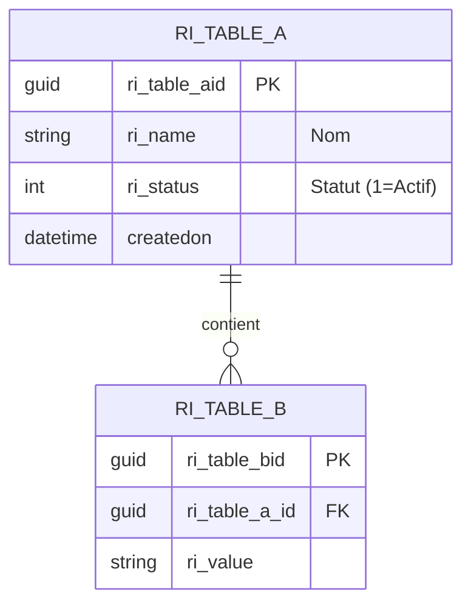
```

After the diagram, include the data dictionary table:

| Table (schéma) | Colonne | Type | PK/FK | Description |
|----------------|---------|------|-------|-------------|
| ri_table_a | ri_table_aid | guid | PK | Identifiant unique |
| ri_table_a | ri_name | string | — | Nom de l'entité |

Include ALL tables and columns from the specification. Include default values and nullable constraints where specified.

**Criticality:** Mandatory. [GAP] if no field-level data found.

---

### [STD-05] Règles techniques (TR-NNN) {#std-05}

**Content:** Complete table of all Technical Rules with full technical detail including formulas.

| ID | Description | Formule / Algorithme | S'applique à | Statut |
|----|-------------|----------------------|--------------|--------|
| TR-001 | Description | `exact formula or algorithm text` | Component | OPEN |

Include exact formula text, regex patterns, and algorithm descriptions verbatim from the specification.

**Criticality:** Mandatory. [GAP] if no TR-NNN found.

---

### [STD-06] Flux techniques détaillés {#std-06}

**Content:** For each technical flow (Power Automate flow, scheduled automation, trigger logic):

1. Flow name + trigger condition
2. Detailed sequence diagram with system actors, exact action types, connector details:

```markdown
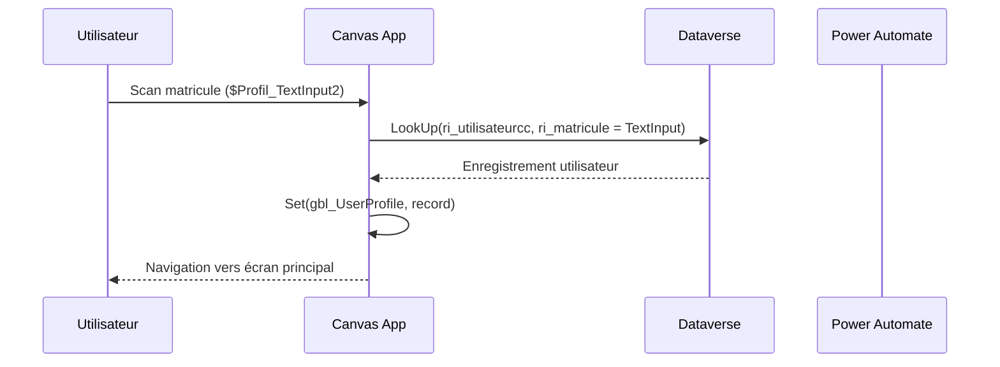
```

Include exact control names, formula calls, and connector action names from the specification.

**Criticality:** Standard. [GAP] if no flows identified.

---

### [STD-07] Spécification des interfaces {#std-07}

**Content:**
1. List of all screens with their Canvas App name and purpose
2. Navigation flow diagram:

```markdown
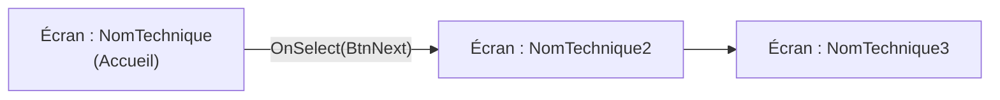
```

3. For each screen: table of key controls with their identifier, type, and bound formula/data source.

| Contrôle | Identifiant | Type | Formule / Source |
|----------|-------------|------|-----------------|
| Champ matricule | $Profil_TextInput2 | TextInput | OnChange: Set(gbl_Matricule, Self.Text) |

**Criticality:** Standard. [GAP] if no screen/control data.

---

### [STD-08] Contraintes d'implémentation (C-NNN) {#std-08}

**Content:** Full constraint table with all technical values (environment IDs, service accounts, versions, licensing).

| ID | Type | Valeur technique | Description | Statut |
|----|------|-----------------|-------------|--------|
| C-001 | Infrastructure | env-id-xxxxxx | Description | OPEN |

**Criticality:** Mandatory.

---

### [STD-08b] Sécurité et authentification {#std-08b}

**Content:** Two sub-sections documenting the security implementation: authentication mechanisms (who can access the system) and access control (what each actor can do).

**Sub-section A — Mécanismes d'authentification**

| Mécanisme | Population | Protocole / Implémentation | Source |
|-----------|------------|---------------------------|--------|
| [mechanism name] | [actors covered] | [technical protocol or provider] | [D-NNN or NFR-NNN] |

**Sub-section B — Contrôle d'accès et autorisations**

| Rôle | Périmètre d'accès | Contraintes | Source |
|------|------------------|-------------|--------|
| [role] | [what the role can access or perform] | [restrictions or conditions] | [D-NNN or FR-NNN] |

**LEGACY mode sourcing:** Extract from:
- TR-NNN entries with security or authentication content (SSO, RBAC, OAuth, permissions)
- C-NNN entries with security constraints (access restrictions, license scoping)
- FR-NNN entries specifying role-based views or auth-gated features

**STD mode sourcing:** Inferred from:
- `stm_decisions` (S4): D-NNN decisions selecting authentication providers or auth architecture → Sub-section A rows
- `stm_actors` (S3): actor profiles with role definitions and permission scopes → Sub-section B rows
- `stm_fr` (S6): FR-NNN entries specifying role-gated views, auth-gated features, or access restrictions → Sub-section B rows
- `stm_nfr` (S11): NFR-NNN entries in Sécurité or Contrainte category with access-scope constraints → supplementary rows or notes in Sub-section B

Derivation rules for STD:
- For each D-NNN selecting an authentication provider (Azure AD, B2C, SSO, OAuth): create one row in Sub-section A
- For each actor in `stm_actors` with a distinct permission scope: create one row in Sub-section B
- From FR-NNN entries that gate features by role: supplement or validate Sub-section B entries
- From NFR-NNN Sécurité category: add as constraints or notes in Sub-section B

**English companion heading:** "Security and Authentication"; sub-sections "Authentication Mechanisms" and "Access Control and Authorizations"; column headers translated accordingly.

**Criticality:** Standard. Emit [GAP] block if no authentication decisions or role-based access rules are found in the specification.

---

### [STD-09] Identifiants techniques {#std-09}

**Content:** Reference table of all stable technical identifiers used in the system.

| Catégorie | Identifiant | Usage |
|-----------|-------------|-------|
| Table Dataverse | ri_lot | Table principale des lots |
| Contrôle Canvas App | $Profil_TextInput2 | Saisie matricule |
| Pattern regex | `^\d+\s?[A-Z]?-LA-\d{1,3}$` | Validation format lot |
| Connexion | Dataverse (current environment) | Connecteur standard |

**Criticality:** Standard.

---

### [STD-10] Cas limites et gestion des erreurs {#std-10}

**Content:** Table of edge cases and error conditions.

| Cas | Condition déclenchante | Message système | Comportement attendu |
|-----|----------------------|-----------------|---------------------|
| Matricule inconnu | LookUp retourne vide | "Le matricule que vous avez saisi est introuvable !" | Blocage navigation |

Include exact error message text verbatim (as it appears in the source specification).

**Criticality:** Standard.

---

### [STD-11] Dépendances et versions {#std-11}

**Content:** Table of external dependencies and required versions.

| Dépendance | Version / Configuration | Criticité |
|------------|------------------------|-----------|
| Power Apps | Premium / Per User | BLOQUANTE |
| Dataverse | Environment standard | BLOQUANTE |
| Power Automate | Premium | BLOQUANTE |

**Criticality:** Optional.

---

## Document 4 — Vue Agent IA (view_agent)

**Format:** Structured Markdown with YAML front-matter and typed bracket identifiers. No HTML cover page. No Mermaid diagrams.

Follow the existing Agent IA format defined in `${CLAUDE_PLUGIN_ROOT}/docs/commands/generate-views_execution.md` Phase 7.

The Agent IA view is **not exported to HTML**. It remains as Markdown only.

**STD spec additions (when `spec_format = STD`):**

After the standard RULE[], ENTITY[], WORKFLOW[], TERM[], ACTOR[] blocks, also emit the following typed blocks from the STD content map:

```
REQUIREMENT[FR-001]:
  description: "Le système [capacité]"
  br_source: BR-001
  priority: HAUTE
  domaine: [Domaine]
  source: DK
  statut: ACTIF

ACCEPTANCE[AC-001]:
  fr_covered: FR-001
  given: "[État initial]"
  when: "[Action déclenchante]"
  then: "[Résultat attendu]"
  statut: DK

NFR[NFR-001]:
  category: Performance | Disponibilité | Capacité | Sécurité | Contrainte
  description: "[Description de l'exigence]"
  seuil: "[≤ Xs | ≥ X% | —]"
  source: [C-NNN (DK) | Source directe (SF)]
  statut: ACTIF

OPEN_POINT[OP-001]:
  description: "[Description du point ouvert]"
  impact: BLOCKING | ADVISORY
  priorite: HAUTE | MOYENNE
  statut: OPEN | IN_PROGRESS | CLOSED | DEFERRED
```

In STD mode, do not emit RULE[] blocks for C-NNN (deprecated at spec level in STD workspaces). CONSTRAINT[] blocks are superseded by NFR[] blocks.

The INFERENCE_REGISTRY[] block remains mandatory for both LEGACY and STD specs — emit after all typed blocks with no filtering (complete verbatim), using `## Annexe A — Inference Registry` as source for STD specs.

---

## Document 4.5 — Plan de Tests (view_qa)

**Standard reference:** ISTQB Foundation Level Test Plan + IEEE 829:1998

**Compliance target (ADR-006 DQM-4):** Phase 1: 78% — Phase 2: 89%. DOC-RT-01 adds IEEE 829 mandatory sections QA-03c (Test Strategy), QA-03d (Test Levels), QA-03e (Entry/Exit Criteria), QA-03f (Test Data), QA-07b (Roles), QA-07c (Suspension Criteria) to meet these targets.

**Content scope:** Testability-focused. Include: testable business rules as test conditions, edge cases, constraints with test impact, governance uncertainties as test risks. Exclude: formulas, control identifiers, Provenance Index, raw KPM Status.

**KPM/Governance (ADR-004 WP-4):** Apply the KPM Filtering Policy — view_qa rules. Governance uncertainty section (`[QA-06]`) is emitted when `ir_pending_structural[]` or `ir_undefined[]` is non-empty.

### Section structure

---

### [QA-01] Page de couverture

Same structure as SF-01 with `cover-doc-type` = "Plan de Tests".

---

### [QA-01b] Historique des Révisions

<!-- AUTO-GENERATED — DO NOT EDIT -->

**Generation rule (DQM-2):** Parse the workspace lifecycle registry for all events of type `INITIAL_BASELINE` and `EVOLVE_BASELINE`, ordered chronologically.

- If no `INITIAL_BASELINE` event exists: **omit this entire section** — not a `[GAP]` condition (the view is generated before formal baseline).
- If events exist: emit the table below with one row per event. Number rows sequentially: v1.0, v2.0, v3.0, ...

| Version | Date | Nature | Description |
|---------|------|--------|-------------|
| v1.0 | {{INITIAL_BASELINE_DATE}} | Baseline initiale | Première version officielle |
| v2.0 | {{EVOLVE_BASELINE_DATE}} | {{EVOLVE_NATURE}} | {{EVOLVE_DESCRIPTION or —}} |

The same history appears identically across all four views generated from the same canonical specification.

---

### [QA-02] Table des matières

```html
<div class="toc">
<h2>Table des matières</h2>
<ol>
<li><a href="#qa-03">Périmètre de test</a></li>
<li><a href="#qa-03c">Stratégie de Test</a></li>
<li><a href="#qa-03d">Niveaux de Test</a></li>
<li><a href="#qa-03e">Critères d'Entrée et de Sortie</a></li>
<li><a href="#qa-03f">Données de Test</a></li>
<li><a href="#qa-04">Conditions de test — règles de gestion</a></li>
<li><a href="#qa-05">Cas limites et valeurs aux bornes</a></li>
<li><a href="#qa-06">Incertitudes et risques de test</a></li>
<li><a href="#qa-07">Critères d'acceptation</a></li>
<li><a href="#qa-07b">Rôles et Responsabilités de Test</a></li>
<li><a href="#qa-07c">Critères de Suspension et de Reprise</a></li>
<li><a href="#qa-08">Validation et signatures</a></li>
</ol>
</div>
```

---

### [QA-03] Périmètre de test {#qa-03}

**Content:**
- Fonctionnalités dans le périmètre de test (derived from specification scope)
- Fonctionnalités hors périmètre de test
- Environnements et accès requis (business-level description — no environment IDs)

**Criticality:** Mandatory.

---

### [QA-03c] Stratégie de Test {#qa-03c}

**Standard reference:** IEEE 829:1998 § 4.2 — Test Strategy. Mandatory section.

**Source:** Inferred from `stm_actors` (actor roles), `stm_nfr` (NFR categories: Performance, Sécurité, Disponibilité), and `stm_fr` (functional scope breadth).

**Content:** Describe the test approach for each test type applicable to the specification.

| Type de test | Description | Approche | Automatisation |
|--------------|-------------|----------|----------------|
| Tests fonctionnels (UAT) | Validation des règles métier (BR-NNN) et critères d'acceptation (AC-NNN) par les acteurs utilisateurs | Tests manuels guidés sur environnement UAT | Non automatisé — validation humaine requise |
| Tests d'intégration (SIT) | Validation des flux entre composants (Power Automate, Dataverse, API) | Scénarios end-to-end sur environnement intégré | Partielle (monitoring des flux Power Automate) |
| Tests de non-régression | Vérification de stabilité après correction ou évolution | Re-jeu des cas de test validés | À évaluer selon maturité du test |
| Tests de performance | Validation des seuils NFR Performance et Capacité | Tests de charge ciblés sur scénarios critiques | Recommandée |
| Tests de sécurité | Validation des profils d'accès et contraintes Sécurité | Tests de rôle + vérification des permissions Dataverse | Partielle (gestion des rôles) |

**Inference logic — adapt the table to the specification:**
- Always include: UAT (mandatory for any spec with BR-NNN or AC-NNN)
- Include SIT: if integration flows identified or `stm_actors` contains more than 1 actor
- Include performance tests: if `stm_nfr` contains a Performance or Capacité category NFR
- Include security tests: if `stm_nfr` contains a Sécurité category NFR
- If no NFR found: include UAT and SIT rows minimum; emit `[GAP]` for performance and security rows

**Criticality:** Mandatory. [GAP] if no specification scope data available.

---

### [QA-03d] Niveaux de Test {#qa-03d}

**Standard reference:** IEEE 829:1998 § 4.3 — Test levels. Mandatory section.

**Source:** Derived from specification structure: `stm_br` (business rules → UAT), `stm_fr` (functional requirements → integration), `stm_ac` (acceptance criteria → UAT), `stm_nfr` (non-functional → system testing), technical rules TR-NNN (→ unit level).

**Content:** Matrix of test levels, scope, responsibility, and passage criteria.

| Niveau | Périmètre | Responsable | Critères de passage |
|--------|-----------|-------------|---------------------|
| Niveau 1 — Tests unitaires | Règles techniques (TR-NNN), formules Power Apps, logiques de calcul | Développeur | Toutes les TR-NNN validées en isolation |
| Niveau 2 — Tests d'intégration (SIT) | Flux Power Automate, connecteurs Dataverse, intégrations API | Technical Lead | Tous les flux end-to-end sans erreur bloquante |
| Niveau 3 — Tests de recette (UAT) | Règles de gestion (BR-NNN), critères d'acceptation (AC-NNN) | Acteurs utilisateurs + QA Lead | 100% des AC-NNN verts |
| Niveau 4 — Tests système (NFR) | Exigences non fonctionnelles (NFR-NNN) : performance, sécurité, disponibilité | QA Lead | Seuils NFR-NNN définis dans la spécification atteints |

**Inference logic — include only applicable levels:**
- Level 1 (unit): include if TR-NNN rules exist in specification
- Level 2 (SIT): include if integration flows or multiple components identified
- Level 3 (UAT): always include if BR-NNN or AC-NNN exist
- Level 4 (NFR): include if `stm_nfr` is non-empty; omit silently if no NFR defined

**Criticality:** Mandatory. [GAP] if no BR-NNN or AC-NNN found in specification.

---

### [QA-03e] Critères d'Entrée et de Sortie {#qa-03e}

**Standard reference:** IEEE 829:1998 § 4.4 — Suspension criteria and resumption requirements. Mandatory section.

**Content:** Formal entry and exit conditions for test execution.

**Critères d'entrée (conditions avant démarrage des tests) :**

| Condition | Vérification | Responsable |
|-----------|-------------|-------------|
| Spécification canonique BASELINED | `spec.status = BASELINED` dans le lifecycle registry | QA Lead |
| Environnement de test disponible et stable | Environnement UAT accessible, données initiales chargées | Technical Lead |
| Cas de test rédigés et revus | Tableau QA-04 complété et validé par le QA Lead | QA Lead |
| Décisions structurelles validées | `ir_pending_structural[]` vide ou USER_VALIDATED | Product Owner |

**Critères de sortie (conditions de clôture des tests) :**

| Condition | Seuil | Responsable |
|-----------|-------|-------------|
| Couverture BR-NNN | 100% des règles de gestion testées | QA Lead |
| Couverture AC-NNN | 100% des critères d'acceptation PASS | QA Lead |
| Couverture NFR-NNN | Seuils définis dans `stm_nfr` atteints | Technical Lead |
| Anomalies bloquantes | 0 anomalie bloquante ouverte | QA Lead + Product Owner |

**Inference notes:**
- If `stm_nfr` is empty: replace the NFR-NNN row in exit criteria with `[GAP]` — "Seuils NFR non définis : compléter Section 11 de la spécification canonique."
- If `ir_pending_structural[]` is non-empty at generation time: prepend `> ⚠ Des décisions structurelles sont encore EN ATTENTE — les critères d'entrée ne sont pas satisfaits avant validation Product Owner.`

**Criticality:** Mandatory. [GAP] if no testable elements (BR-NNN, FR-NNN, AC-NNN) found in specification.

---

### [QA-03f] Données de Test {#qa-03f}

**Source:** Derived from `stm_data` (data entities from canonical spec, Section 10) and `stm_nfr` (volume and capacity NFRs, Section 11).

**Content:** Test data requirements for each entity involved in the system.

| Entité | Volume minimal recommandé | Type de données | Source | Disponibilité |
|--------|--------------------------|----------------|--------|---------------|
| {{ENTITY_NAME from stm_data}} | {{capacity from stm_nfr Capacité rows or "À définir"}} | Données réelles anonymisées / jeu de test représentatif | À confirmer avec l'équipe projet | À confirmer |

Populate one row per entity from `stm_data`. For volume: extract from NFR-NNN Capacité rows if available; otherwise write "À définir".

If `stm_data` is empty: emit `[GAP]` block:

```html
<div class="gap-block">
  <div class="gap-block-header">⚠ SECTION INCOMPLÈTE — Données source insuffisantes</div>
  <ul>
    <li><strong>Section :</strong> QA-03f — Données de Test</li>
    <li><strong>Données requises :</strong> entités de données (Section 10 de la spécification canonique)</li>
    <li><strong>Source attendue :</strong> stm_data (tables Dataverse, entités métier)</li>
    <li><strong>Action :</strong> compléter la section Données de la spécification et relancer /generate-views</li>
  </ul>
</div>
```

**Note systématique :** Le contenu réel des données de test (valeurs, jeux de données spécifiques, règles d'anonymisation) est hors périmètre CSR — il doit être défini par l'équipe de test en collaboration avec le responsable projet.

**Criticality:** Standard. [GAP] if no entity data found in `stm_data`.

---

### [QA-04] Conditions de test — règles de gestion {#qa-04}

**LEGACY mode content:** All Business Rules (BR-NNN) and directly testable Constraints (C-NNN), formatted as testable conditions.

| Identifiant | Condition de test | Résultat attendu | Priorité | Statut |
|-------------|-------------------|-----------------|----------|--------|
| BR-001 | Étant donné [contexte], quand [action], alors [résultat attendu] | Outcome spécifique | HAUTE/MOYENNE/BASSE | OPEN |

Transform each BR-NNN plain-language statement into a testable condition format.

**STD mode content:** Three sub-tables in sequence.

**Sub-table A — Règles Métier (BR-NNN)** (from `stm_br`): Same Given/When/Then format as LEGACY.

| Identifiant | Condition de test | Résultat attendu | Priorité | Statut |
|-------------|-------------------|-----------------|----------|--------|
| BR-001 | Étant donné [contexte], quand [action], alors [résultat attendu] | Outcome | HAUTE | ACTIF |

**Sub-table B — Exigences Fonctionnelles (FR-NNN)** (from `stm_fr`): FR-NNN already express system capabilities — transform into test conditions verifying the system performs the stated capability.

| Identifiant | Capacité à tester | Condition de test | Résultat attendu | Priorité | Statut |
|-------------|-------------------|------------------|-----------------|----------|--------|
| FR-001 | Le système [capacité] | Étant donné [état], quand [action], alors [vérification de la capacité] | Capacité confirmée | HAUTE | ACTIF |

**Sub-table C — Critères d'acceptation (AC-NNN)** (from `stm_ac`): AC-NNN are already in Given/When/Then format — copy verbatim as testable conditions.

| Identifiant | FR Couvert | Given | When | Then | Source | Preuve | Démontré en |
|-------------|------------|-------|------|------|--------|--------|-------------|
| AC-001 | FR-001 | [État initial] | [Action déclenchante] | [Résultat attendu] | DK | NON_DÉMONTRÉ | — |

**`Preuve` / `Démontré en` (ADR-007):** copy verbatim from Section 7 of the canonical specification. Never recompute, never infer. In a test plan these two columns are the test result itself — `NON_DÉMONTRÉ` means the test has not been run, which is the expected state of a plan that has not been executed yet, not a gap. **Do not emit `[GAP]` for a `NON_DÉMONTRÉ` row.**

**Criticality:** Mandatory. [GAP] if no BR-NNN found in specification.

---

### [QA-05] Cas limites et valeurs aux bornes {#qa-05}

**Content:** Edge cases, boundary conditions, and error scenarios.

| Cas | Condition déclenchante | Comportement attendu | Priorité |
|-----|----------------------|---------------------|----------|
| Description | État ou entrée déclenchante | Comportement attendu du système | HAUTE/MOYENNE/BASSE |

Derive from constraints, error handling, and boundary conditions in the specification. If edge cases are not explicitly stated: emit a one-line note "à compléter avec l'équipe de test" — do not omit the section.

**Criticality:** Standard.

---

### [QA-06] Incertitudes et risques de test {#qa-06}

**Content:** Governance uncertainties that create test risks. Apply Alert Block from KPM Filtering Policy.

**Sub-section A — Décisions structurelles non validées**

If `ir_pending_structural[]` is non-empty:

```markdown
> ⚠ **Décision de conception à valider**
> Ces éléments doivent être confirmés par le commanditaire avant démarrage de la recette.

| Décision | Rationale | Risque pour les tests | Statut |
|---|---|---|---|
| <Élément> | <Rationale> | Comportement final non confirmé — tests conditionnels | ⚠ EN ATTENTE DE VALIDATION |
```

If `ir_pending_structural[]` is empty: write `Aucune décision structurelle non validée.`

**Sub-section B — Éléments non définis dans les sources**

If `ir_undefined[]` is non-empty:

| Élément | Risque pour les tests |
|---|---|
| <Élément> | Comportement non spécifié — à clarifier avant recette |

If `ir_undefined[]` is empty: write `Aucun élément non défini dans les sources.`

**Criticality:** Standard. If both lists are empty: write `Aucune incertitude de gouvernance identifiée.` and continue.

---

### [QA-07] Critères d'acceptation {#qa-07}

**Content:** Overall acceptance criteria for the system.

| Critère | Condition de passage | Responsable | Statut |
|---------|---------------------|-------------|--------|
| Règles de gestion | Toutes les BR-NNN valident leurs conditions de test | QA Lead | — |
| Décisions structurelles | Toutes les décisions PENDING_VALIDATION sont USER_VALIDATED avant démarrage recette | Product Owner | — |
| Contraintes | Toutes les C-NNN sont validées en environnement cible | Technical Lead | — |

Adapt criteria to the specification's actual BR-NNN, C-NNN counts. In STD mode: adapt to FR-NNN and AC-NNN counts from `stm_fr` and `stm_ac`.

**Criticality:** Mandatory.

---

### [QA-07b] Rôles et Responsabilités de Test {#qa-07b}

**Source:** Derived from `stm_actors` (actor profiles from canonical spec, Section 3). Standard QA roles (QA Lead, Product Owner, Technical Lead) are always emitted regardless of actor data availability.

**Content:** Table of all test roles and their responsibilities.

| Rôle | Responsabilité principale | Source |
|------|--------------------------|--------|
| QA Lead | Pilotage du plan de test, validation des critères de sortie, coordination recette, signature du plan | Standard (CSR) |
| Product Owner | Validation des BR-NNN et AC-NNN en contexte métier, arbitrage des anomalies, approbation du plan | Standard (CSR) |
| Technical Lead | Validation des TR-NNN, exécution des tests d'intégration (SIT), gestion de l'environnement de test | Standard (CSR) |
| {{ACTOR_NAME}} | Exécution des tests de recette métier (UAT) pour son périmètre fonctionnel | Spécification — acteur utilisateur |

For each actor in `stm_actors`: add one row with the actor profile name and their UAT responsibility derived from their functional domain and permissions.

If no actors are defined in the specification: emit `[GAP]` block for the actor rows only (the three standard rows are always present):

```html
<div class="gap-block">
  <div class="gap-block-header">⚠ SECTION INCOMPLÈTE — Données source insuffisantes</div>
  <ul>
    <li><strong>Section :</strong> QA-07b — Acteurs UAT</li>
    <li><strong>Données requises :</strong> profils acteurs (Section 3 de la spécification canonique)</li>
    <li><strong>Source attendue :</strong> stm_actors</li>
    <li><strong>Action :</strong> compléter les profils acteurs et relancer /generate-views</li>
  </ul>
</div>
```

**Criticality:** Standard.

---

### [QA-07c] Critères de Suspension et de Reprise {#qa-07c}

**Content:** Conditions under which test execution is suspended and when it may be resumed.

**Critères de suspension :**

| Condition | Seuil / Indicateur | Action immédiate |
|-----------|-------------------|-----------------|
| Taux d'échec élevé | > 30% des cas testés en échec sur une session de test | Suspendre — analyser les échecs avant de poursuivre |
| Instabilité de l'environnement | Erreur système bloquante rendant les tests impossibles | Suspendre — escalader au Technical Lead |
| Anomalie bloquante non prévue | Comportement inattendu bloquant plusieurs scénarios de test | Suspendre — soumettre au Product Owner pour décision |
| Décision structurelle non validée | `ir_pending_structural[]` non vide au démarrage de la recette | Ne pas démarrer — attendre validation Product Owner |

**Critères de reprise :**

| Condition ayant causé la suspension | Critère de reprise |
|------------------------------------|-------------------|
| Taux d'échec > 30% | Analyse effectuée, anomalies documentées, plan de correction validé par QA Lead |
| Instabilité environnement | Environnement stable confirmé par Technical Lead |
| Anomalie bloquante | Décision Product Owner documentée (correction planifiée ou acceptation du risque) |
| Décision structurelle en attente | `ir_pending_structural[]` vide ou USER_VALIDATED par Product Owner |

**Criticality:** Standard.

---

### [QA-08] Validation et signatures {#qa-08}

**Content:** Sign-off table for test plan approval.

| Rôle | Nom | Date | Signature | Verdict |
|------|-----|------|-----------|---------|
| QA Lead | | | | |
| Product Owner | | | | |
| Technical Lead | | | | |

**Criticality:** Mandatory.

---

## Bilingual generation

Each of the four human-facing views (SF, DAT, STD, QA) is generated as a bilingual pair.

**Primary language** = workspace primary language from `runtime/workspaces.md`.

Generate primary language first, then translate:

- Translate: section headings, narrative text, table labels, cover page fields, TOC entries, [GAP] messages
- Do NOT translate: rule IDs (BR/TR/C-NNN), status codes (OPEN, BASELINED, PENDING_*), table schema names, control identifiers, formulas, regex, proper nouns, file paths
- [GAP] block label: translate "SECTION INCOMPLÈTE — Données source insuffisantes" → "INCOMPLETE SECTION — Insufficient source data" for EN files
- Cover page field "Langue:" value → "Français" / "English" respectively

**File naming:**

```text
WORKSPACE_ROOT/specifications/views/<base>_specification_fonctionnelle_fr.md
WORKSPACE_ROOT/specifications/views/<base>_functional_specification_en.md
WORKSPACE_ROOT/specifications/views/<base>_dossier_architecture_fr.md
WORKSPACE_ROOT/specifications/views/<base>_technical_architecture_en.md
WORKSPACE_ROOT/specifications/views/<base>_specification_technique_fr.md
WORKSPACE_ROOT/specifications/views/<base>_technical_specification_en.md
WORKSPACE_ROOT/specifications/views/<base>_plan_tests_fr.md
WORKSPACE_ROOT/specifications/views/<base>_test_plan_en.md
WORKSPACE_ROOT/specifications/views/<base>_view_agent_fr.md
WORKSPACE_ROOT/specifications/views/<base>_view_agent_en.md
```

---

## Generation report

At the end of execution, emit a summary:

```text
GENERATE-VIEWS REPORT
=====================
Workspace: <workspace_id>
Canonical spec: <path> (SP-NNN, BASELINED <date>)
Primary language: <fr | en>

Documents generated:
  ✓ Spécification Fonctionnelle    FR: <path> | EN: <path>
  ✓ Dossier d'Architecture        FR: <path> | EN: <path>
  ✓ Spécification Technique       FR: <path> | EN: <path>
  ✓ Plan de Tests                 FR: <path> | EN: <path>
  ✓ Vue Agent IA                  FR: <path> | EN: <path>

[GAP] blocks emitted: N
  - <Document>/<Section> : <reason>

Sections omitted (optional, no data): N
  - <Document>/<Section>
```
