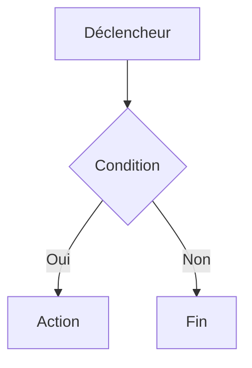

# [Titre de la Spécification]

> **Template :** spec_canonical_v1 — CSR CURRENT_RUNTIME_VERSION
> **Légende obligations :**
> - `[OBL]` — Section toujours présente dans une spec STD conforme
> - `[COND]` — Section présente uniquement si la condition de présence est satisfaite
> - `[À DÉFINIR]` — Placeholder US — bloque le BASELINE si non résolu
>
> **Identifiants de spec (workspaces STD) :**
>
> | Préfixe | Type | Séquence | Gel BASELINE |
> |---|---|---|---|
> | BR-NNN | Business Rule | BR-001, BR-002, ... | Oui |
> | TR-NNN | Technical Rule | TR-001, TR-002, ... | Oui |
> | D-NNN | Design Decision | D-001, D-002, ... | Oui |
> | FR-NNN | Functional Requirement | FR-001, FR-002, ... | Oui |
> | AC-NNN | Acceptance Criteria | AC-001, AC-002, ... | Oui |
> | NFR-NNN | Non-Functional Requirement | NFR-001, NFR-002, ... | Oui |
> | OP-NNN | Open Point | OP-001, OP-002, ... | Non (résolu par HITL) |
>
> **Note :** C-NNN est DEPRECATED comme identifiant spec-level dans les workspaces STD (`spec_template_version: v1`). C-NNN reste actif dans le KB (`_knowledge.md`) de tous les workspaces.

---

## Section 0 — Résumé Exécutif `[OBL]`

> **Généré automatiquement par /generate-specification.** Chaque affirmation est vérifiable
> par référence croisée à une section S1–S15. Aucun fait nouveau n'est introduit ici.
>
> Structure de S0 (5 éléments) :
> 1. Objet et contexte (→ S1)
> 2. Portée fonctionnelle — nombre FR actifs (→ S6)
> 3. Règles métier clés — nombre BR (→ S5) + décisions critiques (→ S4)
> 4. Points d'attention — nombre Points Ouverts (→ S13)
> 5. Statut — état BASELINE / Points Ouverts bloquants (→ S13 + S15)

[Résumé généré depuis les sections S1–S15.]

---

## Section 1 — Contexte et Objectifs `[OBL]`

### 1.1 Contexte

[Description du contexte métier, organisation, situation actuelle et besoins ayant motivé ce projet.]

### 1.2 Objectifs

[Objectifs attendus du système ou de la solution spécifiée. Formuler comme des résultats attendus mesurables ou observables.]

---

## Section 2 — Périmètre `[OBL]`

### 2.1 Inclus

[Description de ce que le système couvre : fonctionnalités, acteurs, processus, périmètre géographique ou organisationnel si pertinent.]

### 2.2 Limites

[Frontières du système — éléments à la limite du périmètre inclus sous conditions, ou qui nécessitent un accord explicite.]

> **Lien :** Pour les éléments explicitement exclus, voir Section 12 — Hors Périmètre.

---

## Section 3 — Profils Utilisateurs `[COND — présente si des acteurs humains interagissent avec le système]`

> **Condition de présence :** Cette section est incluse si le système adresse des utilisateurs humains identifiables.
> **Condition d'absence :** Systèmes purement automatisés, pipelines sans interface utilisateur directe.

| Rôle | Description | Droits principaux | Volume estimé |
|---|---|---|---|
| [Rôle 1] | [Description du rôle] | [Lecture / Saisie / Administration / ...] | [Nombre d'utilisateurs ou N/A] |
| [Rôle 2] | [Description du rôle] | [...] | [...] |

---

## Section 4 — Décisions de Design `[OBL]`

> Décisions de conception documentées dans les sources ou prises lors de la spécification.
> Chaque décision a une autorité identifiable (source documentaire, session de validation, ou ADR formel).

| ID | Décision | Statut | Source | Justification | Autorité |
|---|---|---|---|---|---|
| D-001 | [Description de la décision] | APPROUVÉE | [Source ou "Décision CSR"] | [Justification courte] | [SF / UV / ADR-NNN] |

> **Statuts :** APPROUVÉE | EN_REVUE | REJETÉE | SUPERSEDED

---

## Section 5 — Règles de Gestion `[OBL]`

> Règles métier extraites des sources (BR-NNN) et règles techniques (TR-NNN).
> Ces éléments sont issus du Knowledge Artifact (`_knowledge.md`).
> Colonne Source : SF = source documentaire, UV = validé HITL, DK = dérivé, ID = inféré, US = à définir.

### 5.1 Règles Métier (BR-NNN)

| ID | Domaine | Description | Priorité | Source | Statut |
|---|---|---|---|---|---|
| BR-001 | [Domaine métier] | [Description de la règle] | HAUTE / MOYENNE / BASSE | SF / UV / DK | ACTIF |

### 5.2 Règles Techniques (TR-NNN)

| ID | Domaine | Description | Priorité | Source | Statut |
|---|---|---|---|---|---|
| TR-001 | [Domaine technique] | [Description de la règle technique] | HAUTE | SF / TS | ACTIF |

---

## Section 6 — Exigences Fonctionnelles `[OBL]`

> Les FR-NNN expriment des **capacités système** — ce que le système est capable de faire ou d'empêcher.
> Ils sont dérivés des BR-NNN (mode DK) ou extraits directement des sources (mode SF).
>
> **Légende Source :**
> - SF = directement observable dans une source ingérée
> - DK = dérivé mécaniquement d'un ou plusieurs BR (inversion de capacité)
> - ID = ajout spec-author sans source directe
> - UV = validé lors d'une session HITL
>
> **Légende Statut :** ACTIF | DEPRECATED | SUPERSEDED

| ID | Priorité | Description | Domaine | BR Source | Source | Statut |
|---|---|---|---|---|---|---|
| FR-001 | HAUTE | Le système [capacité / comportement attendu du système]. | [Domaine] | BR-001 | DK | ACTIF |

> **Forme canonique FR-DK :**
> `"Le système [verbe actif : empêche / réserve / valide / affiche / calcule] [objet / comportement] [condition si pertinente]."`
>
> **Exemple de projection BR → FR :**
> `BR-001 : "Un apprenant ne peut signer qu'une fois par créneau."`
> `→ FR-001 (DK) : "Le système empêche la double signature d'un apprenant sur un même créneau."`

---

## Section 7 — Acceptance Criteria `[OBL]`

> Les AC-NNN formalisent les conditions de validation des FR-NNN en format Given/When/Then.
> Chaque AC est lié à exactement un FR primaire.
>
> **Légende Source :** classification KPM / provenance (ADR-004) — même vocabulaire et même colonne qu'en Sections 5.1, 6 et 11.
> - DK = dérivé mécaniquement d'un FR précis (déterministe)
> - ID:implementation = dérivé avec interprétation d'un FR partiellement ambigu (non-bloquant)
> - UV = validé lors d'une session HITL
> - US = placeholder pour un FR trop vague — **BLOQUE le BASELINE**
>
> **Renommée `Statut` → `Source` le 2026-11-01.** Cette colonne portait un nom de cycle de vie et des valeurs de provenance : dans toutes les autres sections, `Statut` vaut `ACTIF`/`DEPRECATED`/`SUPERSEDED` et la provenance vit dans `Source`. La contradiction n'était pas théorique — elle a produit deux dérives opposées dans deux workspaces réels : `std-real-01` a renommé l'en-tête en `Source` (en suivant la sémantique), `demo-catalog-01` a gardé l'en-tête et inscrit `DRAFT` (en suivant le prompt L3). Même cause, deux résolutions. Le nom suit désormais les valeurs.
>
> **Alias de lecture :** une spécification générée avant cette date nomme la colonne `Statut`, et sa variante anglaise `Status`. Tout lecteur doit accepter `Source` | `Statut` | `Status`. Les spécifications baselinées ne sont pas réécrites (gel post-BASELINE).
>
> **Règle minimale :** Chaque FR ACTIF doit avoir au moins 1 AC non-US au BASELINE.
>
> **Légende Preuve `[ADR-007]` :** axe distinct de `Source`. `Source` dit d'où vient le critère ; `Preuve` dit si le système l'a démontré.
> - `NON_DÉMONTRÉ` = **valeur par défaut à la génération.** Aucune exécution n'a encore établi ce critère — état normal d'une spécification fraîche
> - `DÉMONTRÉ` = établi par un événement d'exécution ; `Démontré en` est alors obligatoire
> - `INFIRMÉ` = une exécution a montré que le système ne satisfait pas ce critère — **contradiction à traiter**
>
> **`NON_DÉMONTRÉ` ne bloque PAS le BASELINE** (ADR-007 §5.1). Une case de preuve vide signale que le monde n'a pas rattrapé la spécification, non qu'il manque quelque chose à la spécification.

| ID | FR Couvert | Given | When | Then | Source | Preuve | Démontré en |
|---|---|---|---|---|---|---|---|
| AC-001 | FR-001 | [État initial du système ou de l'utilisateur] | [Action déclenchante ou événement] | [Résultat attendu du système] | DK | NON_DÉMONTRÉ | — |

> **Placeholder AC-US (FR trop vague) :**
>
> | AC-[placeholder] | FR-NNN | [À DÉFINIR — condition de départ] | [À DÉFINIR — action déclenchante] | [À DÉFINIR — résultat attendu] | US | NON_DÉMONTRÉ | — |
>
> **Résolution :** HITL-3 → l'utilisateur définit le contenu. L'ID AC-NNN est conservé après résolution. La valeur `Source` passe de US à UV.

---

## Section 8 — Flux Métier `[COND — présente si des workflows ou processus métier sont documentés dans les sources]`

> **Condition de présence :** La source documente des processus, workflows, ou séquences d'actions identifiables.
> **Format privilégié :** Diagrammes Mermaid (flowchart ou sequenceDiagram).

### 8.1 [Nom du flux principal]



### 8.2 [Nom du flux secondaire si applicable]

[Description narrative ou diagramme du flux]

---

## Section 9 — Interfaces Utilisateur `[COND — présente si des interfaces utilisateur sont documentées ou requises]`

> **Condition de présence :** La source mentionne des écrans, formulaires, ou interfaces utilisateur spécifiques.

### 9.1 Points d'entrée

[Description des points d'entrée dans le système (page principale, menu, URL, etc.)]

### 9.2 Écrans principaux

[Description des écrans ou vues clés. Wireframes ou descriptions textuelles. Référencer les FR correspondants.]

| Écran | FR couverts | Description |
|---|---|---|
| [Nom de l'écran] | FR-001, FR-002 | [Description courte] |

---

## Section 10 — Modèle de Données `[COND — présente si des entités de données sont identifiées dans les sources]`

> **Condition de présence :** La source mentionne des tables, entités, objets, ou structures de données nommées.
> **Obligation :** Si la section est présente, le BDM (§10.1) est obligatoire. Le LDM (§10.2) est conditionnel.

### 10.1 Modèle Conceptuel (BDM)

[Entités principales, attributs clés, relations de haut niveau]

| Entité | Description | Attributs clés | Relations |
|---|---|---|---|
| [NomEntité] | [Description] | [ID, Nom, ...] | [N:1 vers EntitéX] |

### 10.2 Modèle Logique (LDM) `[COND — présent si le détail technique est disponible dans les sources]`

[Tables, champs, types, clés primaires/étrangères, cardinalités]

| Table | Champ | Type | Clé | Description |
|---|---|---|---|---|
| [NomTable] | [NomChamp] | [Type] | PK / FK / — | [Description] |

---

## Section 11 — Exigences Non-Fonctionnelles `[OBL]`

> Les NFR-NNN remplacent C-NNN pour les exigences mesurables dans les workspaces STD.
> La catégorie est une colonne (pas un composant de l'identifiant).
>
> **Catégories :** Performance | Disponibilité | Capacité | Sécurité | Contrainte
>
> **Héritage KPM :** La classification KPM du NFR hérite de celle du C-NNN source (mapping 1:1).
> Si aucune source C-NNN ou source directe → NFR peut être ID:implementation.
>
> **Minimum requis :** Au moins 1 NFR Performance + 1 NFR Disponibilité pour une spec BASELINABLE.
>
> **Preuve `[ADR-007]` :** un seuil est une affirmation mesurable — seule une mesure peut l'établir.
> Même vocabulaire qu'en Section 7 (`NON_DÉMONTRÉ` par défaut · `DÉMONTRÉ` · `INFIRMÉ`), plus la valeur constatée.
> `Mesuré` porte la valeur relevée, à comparer au `Seuil`. `NON_DÉMONTRÉ` ne bloque pas le BASELINE.

| ID | Catégorie | Description | Seuil | Source | Statut | Preuve | Mesuré | Démontré en |
|---|---|---|---|---|---|---|---|---|
| NFR-001 | Performance | [Description de l'exigence de performance] | [≤ Xs, ≥ X req/s, ...] | [C-NNN source (KPM)] | ACTIF | NON_DÉMONTRÉ | — | — |
| NFR-002 | Disponibilité | [Description du SLA ou uptime] | [≥ X% mensuel] | [C-NNN source (KPM)] | ACTIF | NON_DÉMONTRÉ | — | — |

> **Légende Source :** `C-NNN (SF)` = mappé depuis C-NNN de type SF | `C-NNN (DK)` = mappé depuis C-NNN de type DK | `Source directe (SF)` = extrait directement des sources | `Spec author (ID)` = ajouté sans source traceable

---

## Section 12 — Hors Périmètre `[OBL]`

> Éléments explicitement exclus du périmètre de la présente spécification.
> Si aucun élément n'est hors-périmètre, inclure la mention "*(aucun élément exclu)*".

| # | Élément exclu | Justification |
|---|---|---|
| 1 | [Élément ou fonctionnalité exclu(e)] | [Raison : hors-budget, hors-contrat, phase ultérieure, autre système, ...] |

---

## Section 13 — Points Ouverts `[OBL]`

> Les OP-NNN documentent les gaps, questions non résolues, et éléments en attente de décision.
> Les OP-NNN **ne sont pas gelés** au BASELINE — ils évoluent jusqu'à résolution.
>
> **Règle de blocage :**
> - OP-NNN avec source US ou ID:structural PENDING_VALIDATION → **BLOQUE le BASELINE**
> - OP-NNN avec source ID:implementation → WARN (non-bloquant)
>
> Si aucun point ouvert : inclure "*(aucun point ouvert)*".

> **Colonne `Responsable` `[E4]` :** qui doit agir pour fermer ce point. **Vide (`—`) par défaut et jamais inférée** — aucune source ne désigne le responsable d'un trou qu'elle ne sait pas avoir. C'est la même réservation de place que `Preuve` (ADR-007) : CSR ouvre l'emplacement, l'utilisateur le remplit quand la conversation d'affectation a eu lieu.
>
> Un `—` ne bloque aucun gate. Mais un point ouvert sans responsable ne se ferme pas : c'est la raison d'être de la colonne.

| ID | Description | Source | Priorité | Statut | Responsable | Résolution attendue |
|---|---|---|---|---|---|---|
| OP-001 | [Description du point ouvert] | US / ID:structural | HAUTE / MOYENNE | OPEN / IN_PROGRESS / CLOSED / DEFERRED | — | [Prochaine étape ou "CLOSED — résolution: valeur"] |

> **Fermeture :** Un OP résolu est marqué `[CLOSED — résolution: valeur]` dans la colonne Résolution. L'ID OP-NNN est conservé.

---

## Section 14 — Glossaire `[OBL]`

> Tout terme en **gras** dans les sections S1–S13 doit avoir une entrée ici.
> Minimum : 3 termes.

| Terme | Définition | Source |
|---|---|---|
| [Terme 1] | [Définition précise et non-ambiguë du terme dans le contexte de ce projet] | [Source documentaire ou "Définition CSR"] |
| [Terme 2] | [...] | [...] |

---

## Section 15 — Validation et Signatures `[OBL pour BASELINE]`

> Cette section est obligatoire pour le BASELINE.
> Au moins un signataire avec verdict APPROUVÉ est recommandé.

| Rôle | Prénom Nom | Verdict | Date | Commentaire |
|---|---|---|---|---|
| [Responsable Métier] | [Prénom Nom] | APPROUVÉ / RÉSERVÉ / REFUSÉ | [YYYY-MM-DD] | [Optionnel] |
| [Architecte / Tech Lead] | [Prénom Nom] | APPROUVÉ / RÉSERVÉ / REFUSÉ | [YYYY-MM-DD] | [Optionnel] |

> **Verdicts :** APPROUVÉ = validation sans réserve | RÉSERVÉ = validation avec conditions (à documenter) | REFUSÉ = retour en révision

---

## Annexe A — Inference Registry `[OBL post-ADR-004]`

> Ce registre liste les éléments dont la provenance n'est **pas** directement issue d'une source documentaire
> ou d'une validation humaine.
>
> **Éléments ABSENTS de ce registre :** SF, UV, DK (profil de risque nul — non listés).
> **Règle de complétude :** Chaque sous-section doit être présente même si vide. Utiliser `*(aucun élément)*`.

### INFERRED_DESIGN — Impact Structurel

> Ces éléments **bloquent le BASELINE** tant que leur statut est `PENDING_VALIDATION`.
> Critères structurels S1-S4 : nouvelle entité (S1) | nouveaux états lifecycle (S2) | modification périmètre (S3) | impact permissions (S4).
>
> Résolution : Path 1 (validation client → USER_VALIDATED) | Path 2 (ADR formel → ADR_ACCEPTED) | Path 3 (retrait → WITHDRAWN)

| Élément | Statut | Justification | Critère Sx |
|---|---|---|---|
| *(aucun élément)* | — | — | — |

### INFERRED_DESIGN — Détail d'Implémentation

> Ces éléments sont consignés à titre informatif. Ils **ne bloquent pas** le BASELINE.

| Élément | Justification |
|---|---|
| S0 — Résumé Exécutif | Synthèse spec-level des sections S1–S15. Chaque affirmation référence une section du corps de la spec. Vérification lors de HITL-3. |

### TECH_STANDARD

> Ces éléments appliquent un standard industriel documenté. Revue architecturale d'applicabilité recommandée.

| Élément | Standard appliqué | Statut |
|---|---|---|
| *(aucun élément)* | — | — |

### UNDEFINED_IN_SOURCE

> Ces éléments **bloquent le BASELINE** jusqu'à résolution par input humain.

| Position | Description |
|---|---|
| *(aucun élément)* | — |

---

## Annexe B — Specification Provenance `[COND — présente uniquement pour les workspaces multi-source (≥2 sources ingérées)]`

> **Condition de présence :** Le workspace a ingéré 2 sources ou plus via `/ingest-source`.
>
> Cette annexe documente la contribution de chaque source aux éléments de la spec.

### Sources Ingérées

| ID Source | Nom du Document | Date Ingestion | Type | Statut |
|---|---|---|---|---|
| S1 | [Nom du document] | [YYYY-MM-DD] | [Spec fonctionnelle / Brief / Transcript / ...] | INGESTED |
| S2 | [Nom du document] | [YYYY-MM-DD] | [...] | INGESTED |

### Carte de Provenance

| Élément | S1 | S2 | ... | Note |
|---|---|---|---|---|
| BR-001 | ✅ | — | | Source primaire S1 |
| BR-002 | — | ✅ | | Source primaire S2 |
| BR-003 | ✅ | ✅ | | Conflit résolu → [RESOLVED / AMBIGUITY] |

---

## Conventions

### Marqueurs de cycle de vie

| Marqueur | Usage |
|---|---|
| `[v2-modified]` | Élément modifié dans un cycle EVOLVE |
| `[DEPRECATED in v2]` | Élément retiré dans un cycle EVOLVE — ID conservé |
| `[MIGRATED to NFR-NNN in STD v1]` | C-NNN migré vers NFR lors du REOPEN STD |
| `[CLOSED — résolution: valeur]` | OP-NNN fermé avec résolution documentée |
| `[À DÉFINIR — ...]` | Placeholder US bloquant — décrit le gap |

### Règles de gel post-BASELINE

Après BASELINE, les identifiants BR-NNN, TR-NNN, D-NNN, FR-NNN, AC-NNN, NFR-NNN sont **gelés**.
- Aucun renommage, aucune réordonnance, aucune suppression sans marqueur explicite
- Les nouveaux éléments ajoutés en EVOLVE prennent le numéro suivant disponible
- OP-NNN ne sont **pas** gelés — ils évoluent jusqu'à résolution
- Les colonnes `Preuve`, `Mesuré` et `Démontré en` (Sections 7 et 11) ne sont **pas** gelées — même exemption que OP-NNN, et pour la même raison : leur évolution est le déroulement normal du projet, **pas une révision du contenu spécifié**

> **Conséquence `[ADR-007]` — renseigner une preuve ne change pas la version de la spécification et ne déclenche aucun cycle EVOLVE.**
> Le contenu spécifié est inchangé ; seul son état de preuve a évolué. Sans cette exemption, un test réussi ferait passer la spécification à la version majeure suivante.

### Héritage KPM (règle R4 cascade)

Si un élément est dérivé d'une prémisse ID, il hérite de la classification ID :

```
BR source = ID:structural  →  FR dérivé = ID:structural (R4)
FR source = ID             →  AC dérivé = ID (R4)
C-NNN source = ID          →  NFR hérité = ID (R4)
```

---

*Template spec_canonical_v1 — created 2026-07-01. The version marker in the header above is resolved dynamically at generation time (S8, 2026-11-01) and is not this file's own version, which stays spec_canonical_v1.*
*Source : STD Implementation Contract | STD-I1*
